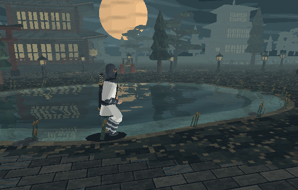

# Пепельный код

Браузерная 3D-игра о молодом ронине в долине, захваченной демонами. Цель — зачистить четыре региона. Счётчик показывает общий прогресс, а точки на мини-карте помогают найти оставшихся противников.



## Запуск

Для разработки нужен Node.js 22.12+ или более новая поддерживаемая версия. Из корня репозитория выполните

```sh
npm ci
npm run dev
```

Откройте адрес, который напечатает Vite. Для проверки релизной версии выполните `npm run build`, затем `npm run preview`. Сборка проверяет типы и записывает статические файлы в `dist/`.

## Telegram Mini App

Разместите содержимое `dist/` на статическом HTTPS-хостинге. В @BotFather выберите своего бота и укажите этот HTTPS-адрес для **Main Mini App** или для кнопки меню через `/setmenubutton`. Откройте игру из чата с ботом. Токен бота для клиентской игры не нужен.

В Telegram приложение раскрывает игровое окно и учитывает безопасные отступы WebView. Системная кнопка «Назад» ставит бой на паузу. При сворачивании игра также приостанавливается. В обычном браузере доступен тот же игровой режим. На телефоне удерживайте кнопку удара для сильной атаки, двигайтесь экранными стрелками и ведите пальцем по сцене для поворота камеры.

## Стек и структура

- **TypeScript** — точка входа `src/main.ts` и адаптер Telegram Web Apps в `src/platform/telegram.ts`. Адаптер проверяет версию клиента перед обращением к дополнительным возможностям.
- **Vite** — сервер разработки, проверка сборки и упаковка ES-модулей. В релизе пути к ресурсам относительные, поэтому игру можно разместить и в подкаталоге.
- **JavaScript ES Modules, Canvas 2D и Web Audio** — симуляция, программный 3D-рендерер и звук в `src/engine/`.
- **HTML и CSS** — интерфейс в `index.html` и `src/ui/`. Портретная раскладка размещает управление под долиной, альбомная — поверх игрового поля.

## Управление

| Действие | Управление |
| --- | --- |
| Перемещение | WASD |
| Свободный осмотр вокруг ронина | Движение мыши |
| Обычный удар в направлении камеры | ЛКМ |
| Длинный взмах с расширенной дугой | ПКМ |
| Достать или убрать меч | V |
| Рывок | Shift |
| Парирование | F |
| Взаимодействие с колоколом | E |
| Пауза и освобождение курсора | Esc |

## Что реализовано и зачем

- **Движение и бой.** Первый удар включает извлечение клинка. Меч остаётся в руке для более быстрых последующих атак. Перенос веса, движение плеч и корпуса делают фазу удара заметной. Рывок и парирование дают возможность пережить ответную атаку.
- **Демоны и столкновения.** Разные противники задают разный темп боя. Попадания нарушают равновесие, а столкновения с препятствиями и другими существами влияют на отбрасывание. Следы ран и эффекты попадания дают обратную связь.
- **Открытая долина.** Тропы, храмы и водоёмы служат ориентирами. Вода замедляет передвижение, кувшины можно разбить, а рядом с колоколом появляется подсказка действия. Мини-карта показывает позицию и направление взгляда ронина.
- **Пиксельный рендеринг.** Игра строит сцену на Canvas из треугольников с буфером глубины. У дальних объектов и отражений меньше геометрии, а внутреннее разрешение подстраивается под нагрузку. Это сокращает время кадра при поворотах камеры и в бою у воды.

## Где искать код

| Файлы | Назначение |
| --- | --- |
| `game.js`, `journey.js` | Ввод, игровой цикл, сложность и правила боя |
| `wanderer.js`, `footing.js`, `combat-fx.js` | Движения ронина, реакции на удары и боевые эффекты |
| `creatures.js`, `bestiary.js` | Модели противников и индикаторы здоровья |
| `valley.js`, `world3d.js` | Карта, физика окружения, вода и отрисовка сцены |
| `index.html`, `src/ui/`, `lettering.js` | Интерфейс и пиксельные заголовки |

В текущем режиме доступны свободное перемещение и бой. В `archive/story.js` сохранена прежняя сюжетная версия с диалогами.
